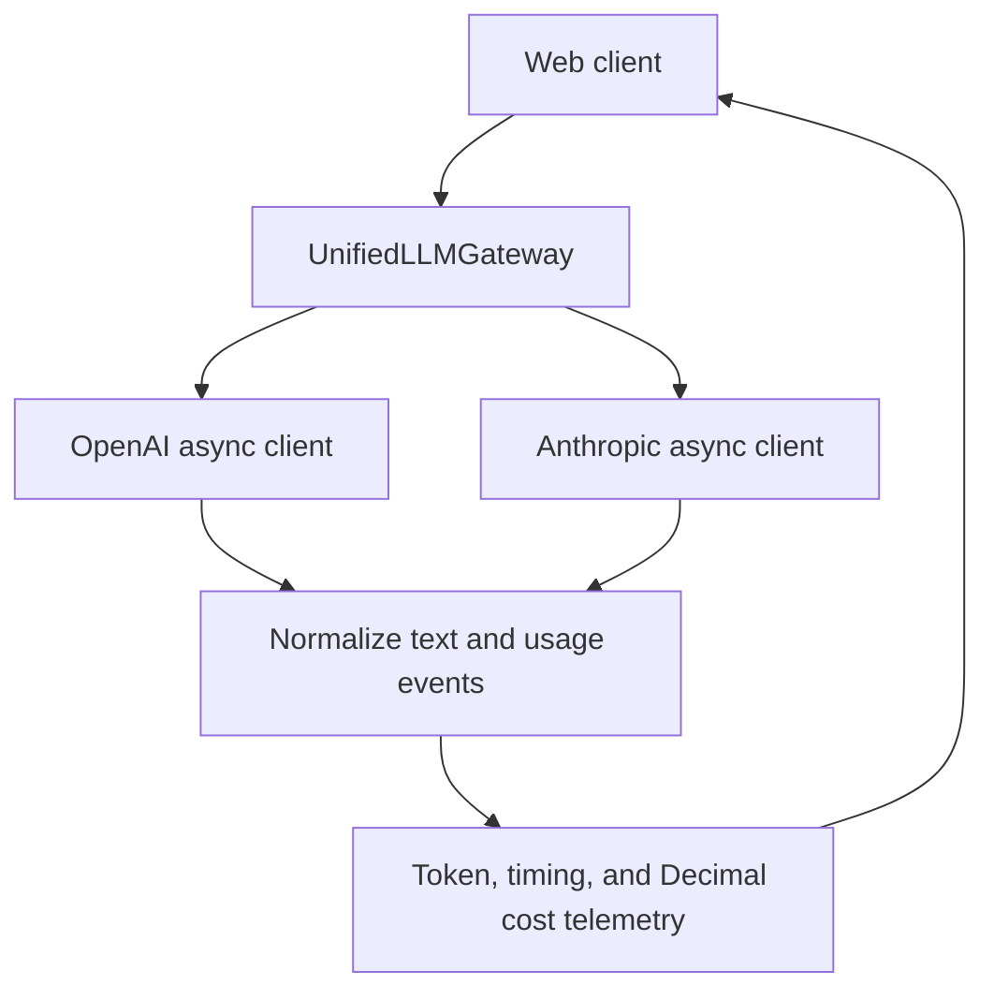

# AD331 Multi-Provider LLM Gateway

**Student:** John Nelson
**Course:** AD 331, Artificial Intelligence
**Assignment:** Week 3, Multi-Provider Async LLM Gateway & Real-Time Telemetry Engine

## Current status

Step 3 AI-assisted audit and fixes are implemented. Ten offline tests pass,
including five regressions reproduced against the preserved Step 2 commit.
John's manual review is still pending. Live provider verification, interactive UI,
full security/QA suite and deployment remain pending. This is not yet a
production service.

## Environment and prerequisites

- Git
- Python 3.11 (managed by `uv`)
- [`uv` project manager](https://docs.astral.sh/uv/getting-started/installation/)
- Provider API credentials, needed later for live integration checks

The assistant's environment is separate from the student's Windows laptop.
The following commands create the local environment after these files have
been published to GitHub.

### Windows PowerShell

If `uv` is not already installed, install it using the official Windows
instructions linked above, then open a new PowerShell terminal.

```powershell
git clone https://github.com/JohnNelson858/AD331-multi-provider-llm-gateway.git
cd AD331-multi-provider-llm-gateway
uv sync --locked
uv run python --version
```

`uv` reads `.python-version`, obtains Python 3.11 if needed, creates `.venv`,
and installs the dependency versions recorded in `uv.lock`. The default sync
also includes the development dependencies. No manual virtual-environment
activation is needed when using `uv run`.

If the repository is already cloned, enter that folder and pull the changes
instead of cloning another copy:

```powershell
git pull --ff-only
uv sync --locked
```

## Project layout

```text
AD331-multi-provider-llm-gateway/
  .python-version
  pyproject.toml
  uv.lock
  .env.example
  .gitignore
  README.md
  ai_prompt_log.md
  docs/
    step2_generation_prompt.md
    step3_refactor.diff
  src/
    __init__.py
    gateway.py
    schemas.py
    pricing.py
    app.py
    demo.py
  tests/
    __init__.py
    test_gateway.py
    test_audit_regressions.py
    test_security.py
```

Runtime dependencies: OpenAI and Anthropic async SDKs, Pydantic v2, tiktoken,
FastAPI, Uvicorn, python-dotenv, and Streamlit. Development dependencies:
pytest and pytest-asyncio. The final UI framework will be chosen during
implementation; installing both web options matches the assignment setup.

## Configuration and security

When live API integration begins, copy the example locally:

```powershell
Copy-Item .env.example .env
```

Replace the placeholders inside `.env` on your own computer. Keep `.env`
private; `.gitignore` excludes it, local environment variants, and Streamlit
secrets. `.env.example` intentionally remains tracked. No keys are needed
for the environment setup itself, and installing the SDKs does not call
either provider.

## Planned architecture

`UnifiedLLMGateway.stream()` yields Pydantic `StreamChunk` objects with normalized
text fragments. One gateway owns pooled async clients on a single application
event loop. Each request has separate counters. The client below will become the
web UI in Step 4; only the terminal demo currently exists.



## Execution and QA

The web app does not launch yet. To verify the prototype without credentials
or provider charges, run:

```powershell
uv run pytest -q
```

These are five initial mocked tests plus five Step 3 regressions, not the complete
Step 5 suite. They check
both providers' normalized output, OpenAI's empty-choices usage tail, Anthropic's
cumulative counters, missing usage/key behavior, and Decimal precision. The
local tokenizer is stubbed. Live usage, pricing invoices, security edge cases,
and real tokenizer comparisons are not verified by these tests. The regressions
cover final Anthropic input/cache updates, partial usage labels, sanitized exception
chains, cleanup after a close failure, and idempotent client ownership handling.

### Optional live terminal demo (later, after key setup and audit)

```powershell
uv run python -m src.demo --help
uv run python -m src.demo --model gpt-4o-mini --prompt "Explain an async generator in two sentences."
uv run python -m src.demo --model claude-haiku-4-5-20251001 --prompt "Explain an async generator in two sentences."
```

The last two commands incur provider API usage. Do not run them until you have
configured keys and confirmed account model access. ChatGPT subscription access
is separate from provider API billing. No paid requests were executed while
preparing this prototype.

### Telemetry definitions

- TTFT: elapsed time from request execution to the first non-empty text delta.
- Elapsed time: includes local preprocessing, networking, and stream consumption.
- Tokens/sec: output tokens divided by total elapsed request seconds. This is
  end-to-end throughput, not a decode-only hardware benchmark.
- Interim OpenAI counts: tiktoken estimates for raw prompt/joined output text.
  Prompt estimates exclude chat framing and are not the final billed input count.
- Final counts: provider-reported usage; missing finish/usage metadata produces
  `IncompleteStreamError` instead of a fabricated successful final event.
- Anthropic interim counters can lag text delivery. `provider_partial` means
  provider counts are present but final usage has not arrived. Supplied cumulative
  input/output/cache values replace earlier snapshots; omitted values are retained.
  It has no tiktoken estimate in this draft.
- Costs remain Decimal values internally and serialize as JSON strings. A UI can
  format six decimal places without discarding the stored precision.
- Zero text output can have `ttft_ms=None`. `stop_reason` preserves limits/refusal
  information for later UI handling. Finalization alone does not mean the answer
  is complete or suitable.

Consumers that stop early should close the async generator with
`contextlib.aclosing`. Close gateway-owned clients at application shutdown.

## Pricing matrix

Standard first-party text prices, USD per 1,000,000 tokens, checked 2026-10-25:

| Model | Input | Output | Cached input | Cache write (5 min) |
| --- | ---: | ---: | ---: | ---: |
| `gpt-4o-mini` | $0.15 | $0.60 | $0.075 | N/A |
| `claude-haiku-4-5-20251001` | $1.00 | $5.00 | $0.10 | $1.25 |

Sources: [OpenAI model pricing](https://developers.openai.com/api/docs/models/gpt-4o-mini),
[Anthropic pricing](https://platform.claude.com/docs/en/about-claude/pricing),
and [Haiku model ID](https://platform.claude.com/docs/en/models/haiku-4-5/overview).
OpenAI marks `gpt-4o-mini` deprecated. It remains the assignment-aligned draft
configuration; verify availability or replace it before the live demonstration.
Access has not been tested for either provider account.

Rates exclude batch discounts, tools, images, regional premiums, custom service
tiers, and contracts. The draft does not request explicit prompt caching. If
cache usage is returned, the calculator handles reads and the default five-minute
Anthropic writes only. Longer cache TTLs need expanded accounting in the audit.
Six USD decimal places is a display requirement, not micro-cent precision.

## Audit and verification summary

See [ai_prompt_log.md](ai_prompt_log.md) and the
[generation prompt record](docs/step2_generation_prompt.md). The initial prototype
is retained as its own commit. Step 3 findings, before-and-after excerpts and
regression evidence are recorded in the log and [source diff](docs/step3_refactor.diff).
Student manual review remains pending. The full
`tests/test_security.py` suite is still pending Step 5.

## Deployment and recording

Pending. The assignment requires a working deployment or local Docker demo
and a 5:00-7:00 walkthrough with a visible webcam overlay.
