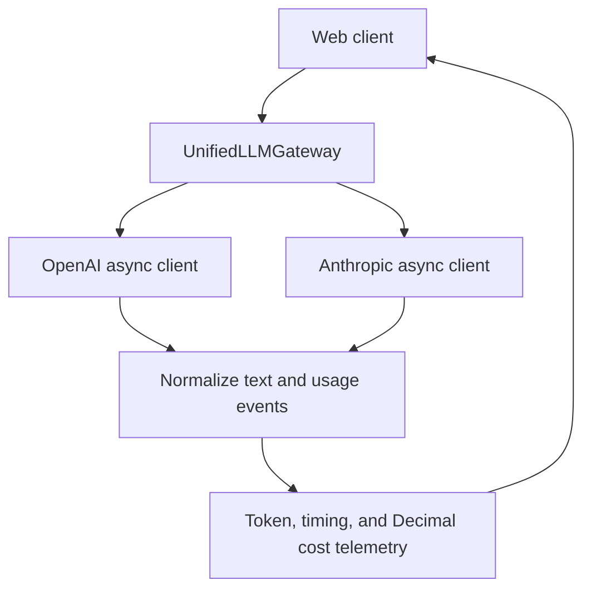

# AD331 Multi-Provider LLM Gateway

**Student:** John Nelson
**Course:** AD 331, Artificial Intelligence
**Assignment:** Week 3, Multi-Provider Async LLM Gateway & Real-Time Telemetry Engine

## Current status

Step 5 is complete. On October 27, 2026, John ran `uv run pytest -v --live`
on his Dell and supplied a terminal screenshot showing **57 passed in 18.50s**,
with no failures or skipped tests. This includes both paid live provider checks.
The default non-live suite remains **55 passed, 2 skipped** by design.
See the [Step 5 QA report](docs/step5_qa.md) for coverage and limitations.

Both providers also returned successful responses in the local web interface.
John completed the Step 3 manual review in `448eb1c`. Haiku 4.5 requests explicitly
use API version `2023-06-01` to retain temperature support with SDK 2.x.
Step 6 deployment is pending. This remains a local development app.

## Environment and prerequisites

- Git
- Python 3.11 (managed by `uv`)
- [`uv` project manager](https://docs.astral.sh/uv/getting-started/installation/)
- Provider API credentials, needed later for live integration checks

The assistant's environment is separate from the student's Windows laptop.
The following commands create the local environment after these files have
been published to GitHub.

### Windows PowerShell

If `uv` is not already installed, install it using the official Windows
instructions linked above, then open a new PowerShell terminal.

```powershell
git clone https://github.com/JohnNelson858/AD331-multi-provider-llm-gateway.git
cd AD331-multi-provider-llm-gateway
uv sync --locked
uv run python --version
```

`uv` reads `.python-version`, obtains Python 3.11 if needed, creates `.venv`,
and installs the dependency versions recorded in `uv.lock`. The default sync
also includes the development dependencies. No manual virtual-environment
activation is needed when using `uv run`.

If the repository is already cloned, enter that folder and pull the changes
instead of cloning another copy:

```powershell
git pull --ff-only
uv sync --locked
```

## Project layout

```text
AD331-multi-provider-llm-gateway/
  .python-version
  pyproject.toml
  uv.lock
  .env.example
  .gitignore
  README.md
  ai_prompt_log.md
  docs/
    step2_generation_prompt.md
    step3_refactor.diff
    step5_qa.md
  src/
    __init__.py
    gateway.py
    schemas.py
    pricing.py
    app.py
    demo.py
    web/
      index.html
      app.js
      style.css
  tests/
    __init__.py
    test_gateway.py
    test_audit_regressions.py
    test_security.py
    test_web.py
    test_pricing.py
    test_live.py
    test_anthropic_transport.py
    conftest.py
    qa_data.py
    web_client_smoke.cjs
```

Runtime dependencies: OpenAI and Anthropic async SDKs, Pydantic v2, tiktoken,
FastAPI, Uvicorn, python-dotenv, and Streamlit. Development dependencies:
pytest and pytest-asyncio. FastAPI + SSE is used for the interface; Streamlit remains an installed alternative
from the assignment setup.

## Configuration and security

When live API integration begins, copy the example locally:

```powershell
Copy-Item .env.example .env
```

Replace the placeholders inside `.env` on your own computer. Keep `.env`
private; `.gitignore` excludes it, local environment variants, and Streamlit
secrets. `.env.example` intentionally remains tracked. No keys are needed
for the environment setup itself, and installing the SDKs does not call
either provider.

## Architecture

`UnifiedLLMGateway.stream()` yields Pydantic `StreamChunk` objects with normalized
text fragments. One gateway owns pooled async clients on a single application
event loop. Each request has separate counters. The browser below is the
web UI. FastAPI owns one gateway for its lifespan; a POST request streams SSE
frames consumed with browser Fetch. Provider credentials never enter the page.



## Execution and QA

### Launch the local web app

From the repository folder in PowerShell:

```powershell
git pull --ff-only
uv sync --locked
uv run uvicorn src.app:app --host 127.0.0.1 --port 8000
```

Keep the terminal running and open <http://127.0.0.1:8000> in your browser.
Press **Ctrl+C** in the terminal to stop the server. Do not launch with
`streamlit run`; this interface uses FastAPI. No provider key is required to
open the page. To generate real responses, configure your local `.env` as
explained above and restart the server. Existing environment variables take
precedence over `.env`. Never paste keys into the prompt or commit them.

1. Choose a provider and its model. Models filter automatically by provider.
2. Enter a prompt, set temperature and the output-token limit, then click
   **Send prompt**. This makes a real, potentially billable API request.
3. Watch text and metrics update. Provider fragments may contain multiple tokens.
   The dashboard marks interim values **PROVISIONAL** and completed usage **FINAL**.
4. **Stop** aborts the browser request; the server closes the upstream generator.
   Partial results stay labeled **INCOMPLETE**. Already processed tokens can still
   be billed, and cancellation does not guarantee an immediate provider-side stop.
5. Missing keys and provider failures appear as readable errors. A failed or
   interrupted stream never becomes a successful final result. Correct keys in
   `.env` and restart the server before retrying.

The page displays provider text as plain text, not HTML or executable Markdown.
Prompts and responses are not persisted by this app. Cost is formatted to six
USD decimal places using Decimal on the server; the exact internal value remains
in telemetry. Configured rates are estimates of API cost, not an invoice.

This app binds to loopback and restricts host/cross-origin browser requests. It
has no public-user authentication or spending quota. Public hosting needs a
separate deployment/security review in Step 6; do not simply expose this port.

### Offline verification

```powershell
uv run pytest -q
```

Current result: **55 passed, 2 skipped**. The default suite makes no paid
provider requests. Gateway tests now use real tiktoken; first use may download
vocabulary data. Checks cover both stream protocols, a fixed fifty-word prompt,
timing, billing precision, malformed keys, secret-bearing SDK exceptions,
cancellation, concurrency, client ownership and the web interface.

The skipped tests are paid real-provider checks. They run only with explicit
`--live` opt-in; instructions and limitations are in the
[Step 5 QA report](docs/step5_qa.md). Local text counts are not identical to
billed chat input. OpenAI's live test checks the ±10% difference for the fixed
prompt; Anthropic is not compared to an OpenAI tokenizer.

If Node.js is already installed, optional client smoke checks run with:

```powershell
node tests/web_client_smoke.cjs
```

Those checks simulate the DOM and streaming transport. They cover progressive
text, split UTF-8, metrics, provider selection, Stop and error recovery. They do
not replace a real browser check. A real local HTTP experiment also confirmed
progressive delivery from a delayed mock provider (first chunk at 0.00 s, later
chunks at 1.50 s). No paid calls were used. Browser visual QA could not run in the
assistant environment because Chromium was unavailable and its download failed.

### Optional live terminal demo (after key setup and account access checks)

```powershell
uv run python -m src.demo --help
uv run python -m src.demo --model gpt-4o-mini --prompt "Explain an async generator in two sentences."
uv run python -m src.demo --model claude-haiku-4-5-20251001 --prompt "Explain an async generator in two sentences."
```

The last two commands incur provider API usage. Do not run them until you have
configured keys and confirmed account model access. ChatGPT subscription access
is separate from provider API billing. No paid requests were executed while
preparing this prototype.

### Telemetry definitions

- TTFT: elapsed time from request execution to the first non-empty text delta.
- Elapsed time: includes local preprocessing, networking, and stream consumption.
- Tokens/sec: output tokens divided by total elapsed request seconds. This is
  end-to-end throughput, not a decode-only hardware benchmark.
- Interim OpenAI counts: tiktoken estimates for raw prompt/joined output text.
  Prompt estimates exclude chat framing and are not the final billed input count.
- Final counts: provider-reported usage; missing finish/usage metadata produces
  `IncompleteStreamError` instead of a fabricated successful final event.
- Anthropic interim counters can lag text delivery. `provider_partial` means
  provider counts are present but final usage has not arrived. Supplied cumulative
  input/output/cache values replace earlier snapshots; omitted values are retained.
  It has no tiktoken estimate in this draft.
- Costs remain Decimal values internally and serialize as JSON strings. A UI can
  format six decimal places without discarding the stored precision.
- Zero text output can have `ttft_ms=None`. `stop_reason` preserves limits/refusal
  information for later UI handling. Finalization alone does not mean the answer
  is complete or suitable.

Consumers that stop early should close the async generator with
`contextlib.aclosing`. Close gateway-owned clients at application shutdown.

## Pricing matrix

Standard first-party text prices, USD per 1,000,000 tokens, checked 2026-10-25:

| Model | Input | Output | Cached input | Cache write (5 min) |
| --- | ---: | ---: | ---: | ---: |
| `gpt-4o-mini` | $0.15 | $0.60 | $0.075 | N/A |
| `claude-haiku-4-5-20251001` | $1.00 | $5.00 | $0.10 | $1.25 |

Sources: [OpenAI model pricing](https://developers.openai.com/api/docs/models/gpt-4o-mini),
[Anthropic pricing](https://platform.claude.com/docs/en/about-claude/pricing),
and [Haiku model ID](https://platform.claude.com/docs/en/models/haiku-4-5/overview).
OpenAI marks `gpt-4o-mini` deprecated. It remains the assignment-aligned draft
configuration; verify availability or replace it before the live demonstration.
John verified both configured models with his account in the October 27 live run.
Future availability must still be checked when preparing the demonstration.

Rates exclude batch discounts, tools, images, regional premiums, custom service
tiers, and contracts. The draft does not request explicit prompt caching. If
cache usage is returned, the calculator handles reads and the default five-minute
Anthropic writes only. Longer cache TTLs need expanded accounting in the audit.
Six USD decimal places is a display requirement, not micro-cent precision.

## Audit and verification summary

See [ai_prompt_log.md](ai_prompt_log.md) and the
[generation prompt record](docs/step2_generation_prompt.md). The initial prototype
is retained as its own commit. Step 3 findings, before-and-after excerpts and
regression evidence are recorded in the log and [source diff](docs/step3_refactor.diff).
John committed his completed manual review in `448eb1c`. Step 4 implementation
and verification limits are recorded in the log. Step 5 adds the credential and
secret-redaction suite, real tokenizer tests and the
[QA coverage report](docs/step5_qa.md). Both live provider tests passed on the Dell
on October 27 (57 tests passed overall).

## Deployment and recording

Pending. The assignment requires a working deployment or local Docker demo
and a 5:00-7:00 walkthrough with a visible webcam overlay.
