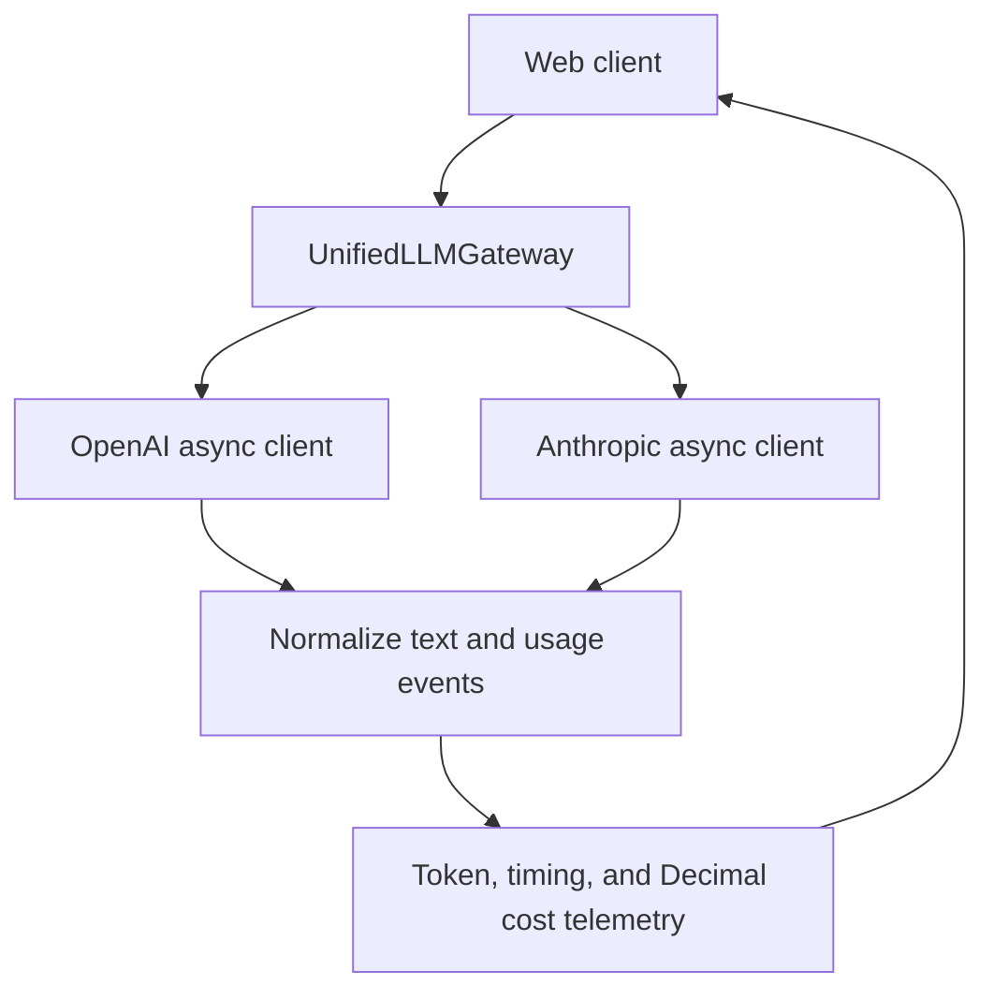

# AD331 Multi-Provider LLM Gateway

**Student:** John Nelson
**Course:** AD 331, Artificial Intelligence
**Assignment:** Week 3, Multi-Provider Async LLM Gateway & Real-Time Telemetry Engine

## Current status

Step 1 environment and project scaffolding only. Gateway implementation,
streaming UI, pricing calculations, QA tests, and deployment are pending.
The files in `src/` and `tests/` currently contain module descriptions only.

## Environment and prerequisites

- Git
- Python 3.11 (managed by `uv`)
- [`uv` project manager](https://docs.astral.sh/uv/getting-started/installation/)
- Provider API credentials, needed later for live integration checks

The assistant's environment is separate from the student's Windows laptop.
The following commands create the local environment after these files have
been published to GitHub.

### Windows PowerShell

If `uv` is not already installed, install it using the official Windows
instructions linked above, then open a new PowerShell terminal.

```powershell
git clone https://github.com/JohnNelson858/AD331-multi-provider-llm-gateway.git
cd AD331-multi-provider-llm-gateway
uv sync --locked
uv run python --version
```

`uv` reads `.python-version`, obtains Python 3.11 if needed, creates `.venv`,
and installs the dependency versions recorded in `uv.lock`. The default sync
also includes the development dependencies. No manual virtual-environment
activation is needed when using `uv run`.

If the repository is already cloned, enter that folder and pull the changes
instead of cloning another copy:

```powershell
git pull --ff-only
uv sync --locked
```

## Project layout

```text
AD331-multi-provider-llm-gateway/
  .python-version
  pyproject.toml
  uv.lock
  .env.example
  .gitignore
  README.md
  ai_prompt_log.md
  src/
    __init__.py
    gateway.py
    schemas.py
    pricing.py
    app.py
  tests/
    __init__.py
    test_gateway.py
    test_security.py
```

Runtime dependencies: OpenAI and Anthropic async SDKs, Pydantic v2, tiktoken,
FastAPI, Uvicorn, python-dotenv, and Streamlit. Development dependencies:
pytest and pytest-asyncio. The final UI framework will be chosen during
implementation; installing both web options matches the assignment setup.

## Configuration and security

When live API integration begins, copy the example locally:

```powershell
Copy-Item .env.example .env
```

Replace the placeholders inside `.env` on your own computer. Keep `.env`
private; `.gitignore` excludes it, local environment variants, and Streamlit
secrets. `.env.example` intentionally remains tracked. No keys are needed
for the environment setup itself, and installing the SDKs does not call
either provider.

## Planned architecture

The following flow describes the intended implementation, not completed code.



## Execution and QA

The app does not launch yet. Exact launch commands will be documented when
Step 4 is implemented. After Step 5 adds tests, run:

```powershell
uv run pytest -v
```

The current test files are placeholders. Pytest will report no tests
collected; this is not evidence that the assignment QA suite passes.

## Pricing matrix

Pending model selection and verification against official provider prices.
No prices, model availability, or billing guarantees are asserted at this stage.

## Audit and verification summary

See [ai_prompt_log.md](ai_prompt_log.md). The initial prototype, manual audit,
and before-and-after fixes are pending. Future checks must distinguish mocked
protocol tests from actual provider integration results.

## Deployment and recording

Pending. The assignment requires a working deployment or local Docker demo
and a 5:00-7:00 walkthrough with a visible webcam overlay.
